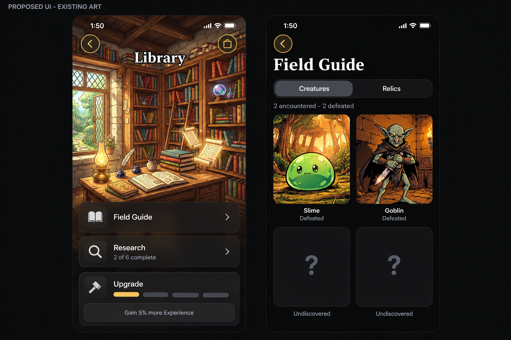
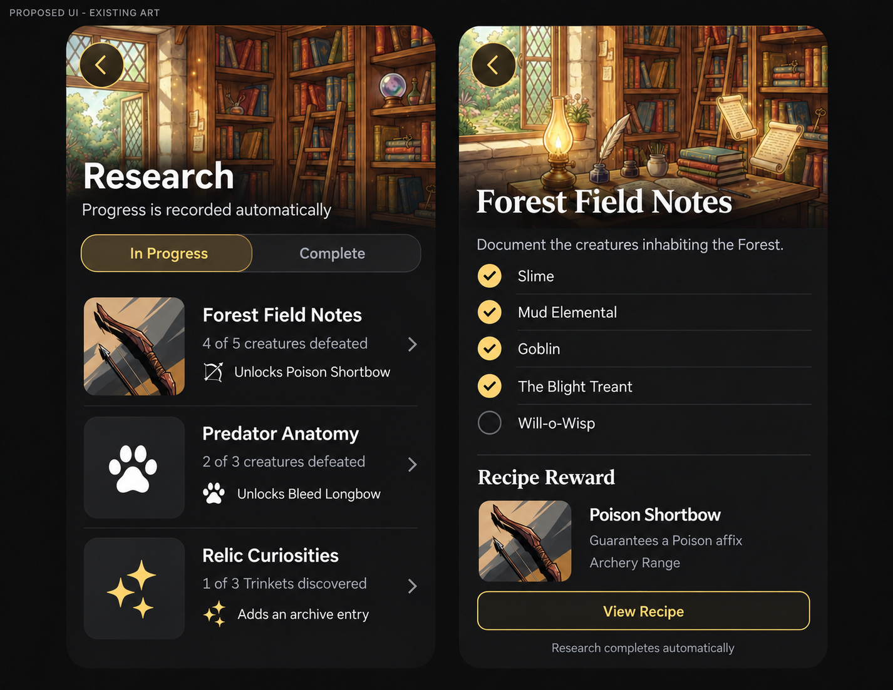
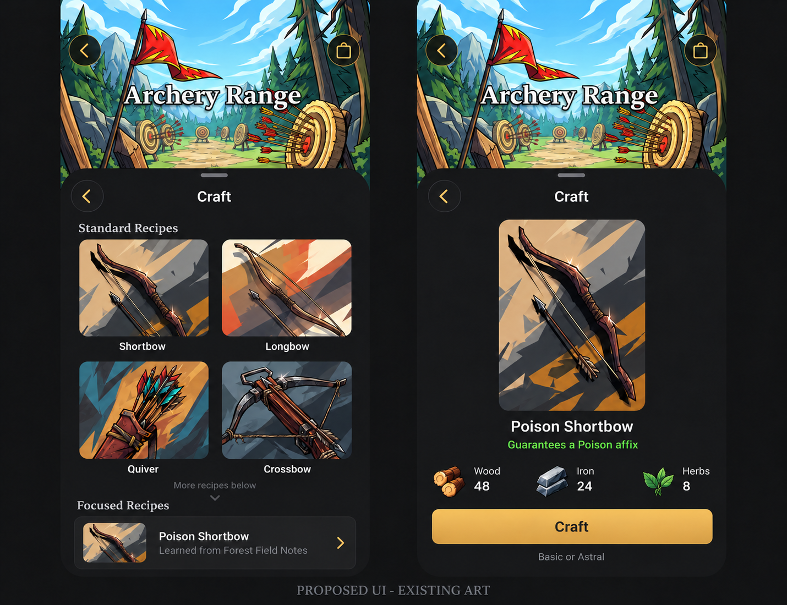

# Library, research, and Archery Range crafting

## Intent and disposition

Adventures fill the Library with discoveries. Completing finite research projects
teaches recipes that the player can use at Archery Range. Existing building,
creature, item, and resource artwork carries the expansion's identity.

This is an implementation-ready design proposal, not a description of shipped
behavior. The user approved this direction and requested a detailed plan and
screenshot-based ImageGen mockups. This task delivers those planning artifacts;
game implementation remains intentionally unstarted. Numeric prices below are
proposed tuning inputs, not balance-verified values. Preserve this active plan for
implementation and use `--keep-plan` when handing off the planning task.

Source baseline: committed local main `5cb25b7d8`, inspected October 17, 2026.
Recheck source paths and current main when implementing. After implementation,
move durable behavior into canonical product/platform owners and retire this plan
under [plan lifecycle](README.md).

## Scope and product boundaries

Deliver together:

- Library Field Guide with Creatures and Relics.
- Six authored research projects, automatic objective tracking, and permanent
  completion records.
- Archery Range crafting: five standard recipes and three research recipes.
- Discovery persistence, bounded historical backfill, save recovery, reset, and
  existing internal-beta cloud synchronization support.
- Full localization and accessible native interactions for the added flows.

Regions remain a later guide section. Runesmith, other workshops, consumables,
hunting activities, combat trials, and research currencies are outside this cut.
Hunter's Lodge retains its existing fieldcraft/companion identity and behavior.

Preserve the five Play modes, permanent Campaign/Spire completion, existing
Collection management, building costs/bonuses/production, immediate upgrades,
continuous battle input, and all existing Blacksmith recipes and prices. No new
game-art masters, asset-manifest entries, illustrated blueprints, equipment bases,
or sound assets. Generated mockups are documentation references, never app assets.

All three new Homestead activities follow current free-edition Homestead access.
Starter research must remain attainable with free content. An objective can count
an accessible Contract enemy without requiring completion of its Campaign region.
Research never grants access to premium floors or characters. Existing ownership
and inspection restrictions remain in force.

## Existing system and reuse

The [Homestead contract](../Product/Homestead.md) and current implementation provide
20 four-tier buildings in Farming, Crafting, Alchemy, Training, and Arcana. Buildings
are independently buildable. Galleries use existing 3:4 portrait crops; details
use full portrait backgrounds with Build/Upgrade and benefit panels.

Blacksmith alone has an activity. Its 11 recipes unlock at tier one. Its native
sheet progresses from recipe grid to cost preview to actual item reveal; tiers
two through four add 10/20/30% forge-only Astral weight. Ordinary forge results
use the highest won encounter level, capped at loot level 40, and permit the
selected base's unowned Unique. The rolled candidate survives silent save retries.

Reuse these specific owners:

| Existing owner | Reuse or bounded extension |
|---|---|
| [Building details](../../Trinket/Features/Homestead/HomesteadDetailViews.swift) | Library activities and Archery Craft beside the existing Blacksmith action |
| [Forge browser](../../Trinket/Features/Homestead/BlacksmithForgeView.swift) | Shared equipment-recipe grid and native sheet navigation |
| [Forge preview/reveal](../../Trinket/Features/Homestead/BlacksmithForgePreview.swift) | Material dock, admitted operation, same-item result, dismissal recovery |
| [Recipe catalog](../../Packages/TrinketContent/Sources/TrinketContent/Homestead/BlacksmithRecipe.swift) | Preserve existing IDs/costs while extracting the small common equipment recipe value |
| [Forge plan](../../Packages/TrinketContent/Sources/TrinketContent/Homestead/BlacksmithForgePlan.swift) | Immutable candidate and current-state revalidation |
| [Forge persistence](../../Packages/TrinketPersistence/Sources/TrinketPersistence/Inventory/BlacksmithForge.swift) | Atomic spending/insertion and cancellation-safe retry ownership |
| [Item reward generator](../../Packages/TrinketContent/Sources/TrinketContent/Equipment/ItemRewardGenerator.swift) | Tier filtering, base selection, keyword-affix guarantee |
| [Collection](../../Trinket/Features/Collection/CollectionView.swift) | Existing portrait/card labels and actual-item destination; equipment management stays here |

The existing save records current inventory and progression, not a complete
lifetime creature/relic history. New history is required; do not infer lifetime
Contract victories from a regenerating offer board.

## Player flows and screen specifications

### Library building

Keep its existing portrait, centered building title, Back/Resources controls,
four-tier progress, upgrade flow, and XP benefit. Above Upgrade show two matching
activity rows:

1. **Field Guide**, native book symbol and chevron; secondary text such as
   `12 creatures encountered` once useful.
2. **Research**, native magnifying-glass symbol and chevron; secondary text
   `2 of 6 complete`.

Tier zero exposes the activity rows with an adjacent `Build Library` requirement;
actions remain disabled until tier one. Tracking always runs. Building Library
applies already-earned facts immediately. Preserve the partially desaturated
unbuilt portrait and all material-only building rules. Completed Library keeps
both activity rows above its completed tier bar.

Use a full-height native push for guide/research reading within the building's
navigation stack. Back returns to the same building position. Keep the building
detail's tab-bar treatment; do not introduce an independent tab or double sheets.

### Field Guide browser

Use a native title, Creatures/Relics segmented control, and portrait cards matching
Collection. Start with catalog order and stable ordering during a visit. Native
search is unnecessary for the first cut unless review demonstrates a finding problem.

Creatures uses the 39 existing enemies, including seven bosses. A discovered card
uses its existing portrait, name, and one status line: `Encountered` or `Defeated`.
Defeated implies encountered. Undiscovered cards use a neutral surface and native
question-mark symbol, with `Undiscovered`; no newly illustrated silhouettes.
Research does not add a separate mastery level to every creature.

Creature detail reuses the portrait and canonical traits/ability descriptions,
then shows related project progress. Numeric enemy values must name their level;
default to the party-scaled Standard Contract reference level, explicitly labeled
as a reference, rather than implying all modes use that level. Existing encounter
inspection remains authoritative for that encounter. Combat information is never
withheld behind research. Merely inspecting an enemy in Contracts or the guide
does not count as encountering it.

Relics has Trinkets/Uniques sections using the authored catalogs. Cards distinguish
`Discovered - Owned` and `Discovered - Not Owned`. Historical knowledge never
creates an InventoryItem, equips anything, or changes collectible drop eligibility.
Missing entries retain current locked-item inspection rules. Owned items can link
to the actual Collection item. Previously discovered but absent relics show a
read-only archive entry, without salvage/equip controls. Do not repurpose the
current Collection's locked card to grant otherwise unavailable item inspection.

Empty state: `Discover creatures and relics on your adventures`; keep both
sections navigable. No forced tutorial, new notification badge, or compulsory
onboarding step.

### Research browser and project detail

Show In Progress/Complete filters, with projects in authored order and higher-tier
projects inspectable. A row contains an existing subject/reward thumbnail or
native symbol, title, objective summary, and exact reward. A Library-tier
requirement is separate from objective progress. For example:

`Forest Field Notes` / `4 of 5 creatures defeated` / `Unlocks Poison Shortbow`.

Project detail shows existing subject art, a short purpose, explicit objective
rows, Library-tier requirement when relevant, and a reward section. Each creature
objective links to that guide entry; the reward links to its recipe. Show native
checkmarks plus text, not color alone. No Accept, research timer, active project
slot, research currency, donation cost, or manual reward-claim action.

Every project tracks all relevant facts automatically. Completion requires its
facts AND minimum Library tier. The player can finish facts before building or
upgrading; the next eligible Library upgrade completes the project without
repeating play. Completed projects and taught recipes are permanent within
the save/reset epoch. No pinning feature is required in this cut.

### Archery Range

Keep its current portrait, ranged-damage benefit, Wood production, upgrades, and
resource access. A built Range adds **Craft** above Upgrade, using a native
bow-and-arrow symbol. Tier zero shows the build requirement consistently with
Library. No prerequisite Library building is imposed on standard crafting.

Craft opens the same kind of native sheet as Forge. Standard Recipes uses the
five equipment cards below. Focused Recipes uses compact rows, reusing the base
thumbnail with keyword text. Show learned entries first, then locked entries in
catalog order captured on opening. Locked entries remain inspectable and name
their research project; returning from research preserves browsing position.

Recipe preview uses the existing material dock and portrait/name arrangement.
Focused previews additionally state `Guarantees a Poison affix` (or the actual
keyword) and `Basic or Astral`. Locked previews replace Craft with their visible
requirement and a View Research action; no button that appears to spend resources.
Unavailable material quantities use the existing insufficient-cost styling.
Ordinary previews retain Forge's concise presentation.

On Craft, disable duplicate submission and show only the existing pending visual.
Spend resources and insert the exact candidate before success feedback. Reveal
the actual item through the current item-detail pattern. No automatic equip.
Reopening the saved result never crafts again. Background/navigation suppresses
late presentation but preserves any accepted item.

Cross-links carry stable project/recipe IDs. Use the current Homestead stack to
navigate to the destination building and present the requested activity; avoid
nested modal stacks. Returning restores the originating guide/project where
practical. If the Range is unbuilt, View Recipe shows the recipe and build
requirement, while crafting remains disabled.

## Initial research catalog

Six projects, three recipe unlocks, three permanent archive passages. Lore passages
below are initial copy proposals, subject to separate editorial/localization
review. This cut adds no material, Gold, XP, or permanent-stat rewards to research.

| Stable project ID | Library tier | Explicit objective | Reward |
|---|---:|---|---|
| `forest-field-notes` | 1 | Defeat Slime, Mud Elemental, Goblin, Will-o-Wisp, The Blight Treant | `archery-shortbow-poison` |
| `relic-curiosities` | 1 | Discover three distinct Trinket template IDs | Archive passage: Relic Curiosities |
| `predator-anatomy` | 2 | Defeat Giant Spider, Giant Snake, Dire Wolf | `archery-longbow-bleed` |
| `companion-chronicles` | 2 | Recruit three distinct Companions, including the starter | Archive passage: Companion Chronicles |
| `arms-and-armor` | 3 | Defeat Goblin, Bandit, Living Armor | `archery-crossbow-physical` |
| `spire-records` | 4 | Clear floor 10 of any Spire | Archive passage: Spire Records |

Enemy IDs come from the actual catalog: `slime`, `mud_elemental`, `goblin`,
`will_o_wisp`, `the_blight_treant`, `giant_spider`, `giant_snake`, `dire_wolf`,
`bandit`, `living_armor`. Duplicate kills never substitute for another objective.
Named targets can be encountered through existing modes; Contracts ordinarily
draws from the full ordinary/boss pools. Do not add forced target spawning or
Contract rerolls. Explain known source regions and Contracts as possible sources
without promising a currently available offer.

Initial archive passages:

- **Relic Curiosities:** Each relic carries a different answer to the same danger.
  The collection records what you found, even when the item has left your pack.
- **Companion Chronicles:** No two companions approach a battle alike. These
  records preserve the growing company that shares your adventures.
- **Spire Records:** Each Spire turns one form of power into a different trial.
  Reaching its tenth floor earns a place in the Library's climbing records.

Passages appear in completed project details; no illustrated book or separate
reward item. Creature pages can link to multiple projects without a research
rank. Future edits must preserve already-earned rewards and stable IDs.

## Recipe catalog and economic rules

Proposed material costs use existing resources; tune before shipping against
Blacksmith, salvage yields, battle income, and passive production. Numbers are
explicit starting points so implementation has a reviewable catalog.

| Recipe ID | Base | Requirement | Wood | Iron | Hide | Herbs | Guarantee |
|---|---|---|---:|---:|---:|---:|---|
| `archery-shortbow` | Shortbow | Range I | 32 | 16 | 0 | 0 | Standard |
| `archery-longbow` | Longbow | Range I | 40 | 20 | 0 | 0 | Standard |
| `archery-recurve-bow` | Recurve Bow | Range I | 40 | 20 | 0 | 0 | Standard |
| `archery-crossbow` | Crossbow | Range I | 32 | 32 | 0 | 0 | Standard |
| `archery-quiver` | Quiver | Range I | 16 | 0 | 32 | 0 | Standard |
| `archery-shortbow-poison` | Shortbow | Forest Field Notes | 48 | 24 | 0 | 8 | Poison affix |
| `archery-longbow-bleed` | Longbow | Predator Anatomy | 60 | 30 | 12 | 0 | Bleed affix |
| `archery-crossbow-physical` | Crossbow | Arms and Armor | 48 | 48 | 0 | 0 | Physical affix |

All focused recipes also require a built Range. The project, rather than a second
Range-tier gate, controls recipe learning. Higher Range tiers add the same
10/20/30% forge-only Astral weight progression used by Blacksmith; they do not add
affixes, alter guarantees, or increase base item power. Preserve existing
combat/production tiers. Add the crafting benefit to Range descriptions during
implementation, with localization.

Standard recipes follow the existing forge's Basic/Astral/selected-base Unique
policy, excluding Trinkets. Focused recipes use only Basic/Astral, renormalizing
the same eligible tier weights. Their one guaranteed keyword affix occupies a
normal affix slot; remaining affixes and magnitudes roll normally. Guarantee the
keyword, not a particular signature, numerical magnitude, or stronger rarity.

Reuse the highest-won reward level with its existing loot-level cap. Never use
research or a roster-only level increase as a new loot-quality source. Generate
on admitted Craft and retain one immutable candidate through retries. Each
deliberate new craft gets a new physical item ID and pays again. Shared ownership
and duplicate-Unique rules apply.

Important current generator detail: with `requiredKeyword`, base selection examines
`baseTypes` BEFORE `fallbackBaseType`. A fixed-base focused recipe must constrain
`baseTypes` to its single selected base as well as validate a reachable affix.
Passing only a fallback can yield a different equipment base. Verify recipe base,
keyword reachability, and allowed tiers at catalog construction/check time.

## Feedback and reachable states

Research progress commits with the gameplay operation that earns it. A victory
may add one compact Research Complete row after ordinary reward information;
coalesce multiple completions and keep the normal Continue flow. Recipe unlock
text names both recipe and workshop. No forced modal or automatic departure from
Play. Reopening a result must not replay completion sound/haptics.

Building/upgrading Library may complete older projects. Finish the existing build
celebration first, then expose a quiet `N research projects complete` summary linked
to Research. Backfilled discoveries do not queue historical victory notifications.
Completion records remain visible if transient notification is interrupted.

| State | Expected behavior |
|---|---|
| No discoveries | Explain discovery through adventures; preserve guide structure |
| Objective met, Library tier too low | Show checks and required Library tier; no recipe grant yet |
| Project complete, Range unbuilt | Recipe learned permanently; show Build Archery Range requirement |
| Missing materials | Inspectable recipe, exact insufficient costs, disabled Craft |
| Pending save | Existing pending treatment and silent retry; no success yet |
| Interrupted accepted craft | Item remains in Collection; no late forced navigation |
| Reset/account change | Retire old callbacks/destinations; reset history only with game progress |
| Full Game access changes | Preserve history; respect access and inspection rules |
| Unknown/damaged discovery data | Preserve bytes and isolate activity availability; keep ordinary play and standard crafting available |

Use existing typography, semantic keyword colors, safe-area resource docks,
native large-text wrapping, reduced-motion behavior, and explicit image labels or
decorative semantics. Critical controls get stable accessibility IDs. No custom
accessibility mode or device-specific layout branch.

## Artwork and mockup references

Only existing art selected in [the curated manifest](../../ArtManifest/curated-assets.tsv)
may ship. Use cropped variants and imminent owner pins; do not preload the entire
guide. Preserve artwork budgets. Native symbols handle books, magnifiers, checks,
question marks, and navigation.

| Surface | Existing manifest identity |
|---|---|
| Library building | `portrait_background / library`, landscape `background / library` |
| Archery building | `portrait_background / archeryRange`, landscape `background / archeryRange` |
| Creature cards/project subjects | `combatant / <actual enemy ID>` |
| Standard/focused recipe art | `item / shortbow-basic`, `longbow-basic`, `recurve_bow-basic`, `crossbow-basic`, `quiver-basic` |
| Actual crafted result | Existing item-art reference, including Astral/Unique mapping |
| Costs | Existing Wood, Iron, Hide, Herbs resource illustrations |

Three screenshot-guided ImageGen boards accompany this plan: Library/guide,
research list/detail, and Archery browser/preview. They are proposed UI, not
implemented features or pixel-accurate SwiftUI specifications. Written rules take
precedence when labels/spacing differ. Illustrative counts/prices show example
states, not real save evidence or validated balance. Reference provenance, exact
prompts and visual review are in [mockup notes](LibraryResearchArchery/Mockups.md).







## Ownership and proposed data contract

Use existing packages. No new package, generic quest engine, workflow service,
event bus, or public protocol is needed.

| Owner | Responsibility |
|---|---|
| TrinketContent | Typed project definitions/objectives, recipes, immutable discovery/research values, pure evaluation and craft candidate rules |
| TrinketPersistence | Authoritative fact admission, durable records and unlocks, atomic crafting/economic receipts, migration/backfill/reset/recovery/cloud merge |
| TrinketAppState | Actual battle-activation/outcome facts and transient navigation/completion presentation |
| Trinket feature UI | Guide, research, activity links and crafting observing narrow save slices |
| TrinketFeatureSupport/DesignSystem | Reuse cards, detail views, feedback and accessibility IDs; add only truly shared pieces |

Proposed Content values, names subject to call-site review:

```text
DiscoveryState
  encounteredEnemyIDs: Set<String>
  defeatedEnemyIDs: Set<String>
  discoveredRelicTemplateIDs: Set<String>
  completedResearchIDs: Set<String>
  unlockedRecipeIDs: Set<String>

ResearchProject
  id, localized title/purpose, existing subject art ID
  minimumLibraryTier, typed objectives, recipe-or-archive reward

ResearchObjective
  defeatEach(enemyIDs)
  discoverDistinctTrinkets(count)
  recruitDistinctCompanions(count)
  reachAnySpireFloor(floor)

EquipmentRecipe
  stable id, buildingID, baseID, cost, optional projectID
  optional requiredKeyword, tier policy
```

Do not store display counts, per-project duplicate kill counters, enemy statistics,
rolled items, or localized text in history. Progress derives from sets and
existing roster/Spire facts. Persist completed project IDs and earned recipe IDs
so catalog retirement does not revoke rewards. Keep unknown stable IDs inert and
round-trippable; grant no unknown effects. Enforce defeated as a subset of
encountered on readable state.

Definitions are a small authored Swift catalog beside existing Homestead content;
avoid a new manifest/generator DSL for six projects. Recipe models can be shared
between Blacksmith and Range because both are confirmed consumers. Preserve
Blacksmith IDs and behavior; review consumers before deleting old APIs.

## Fact admission and transactional invariants

1. **Encountered:** accept the resolved enemy ID only after runtime activation
   succeeds. Preview/preparation/inspection/failed activation do not count. Use a
   generation-bound, idempotent save command and existing silent retry; never gate
   card input or add mid-battle save/resume. A process interruption before this
   record commits cannot promise encounter-history survival; an accepted victory
   also records encountered.
2. **Defeated:** record the actual launched enemy ID with accepted victory
   settlement in every mode. Carry it in the save-issued claim/launch context;
   never reconstruct random encounters from current UI or a replaced offer.
   Duplicate/stale claims grant nothing. Defeat/retreat grants no defeated flag.
3. **Relic discovered:** add accepted Trinket/Unique template IDs wherever item
   admission succeeds: victory (including bonus items), Shop, Mystery, crafting,
   and compatible imports. Never count shown offers, previews, rejected duplicate
   insertions, or uncommitted rolls. Scan retained inventory during hydration and
   reconciliation. Basic/Astral variants are not collectible discoveries.
4. **Research:** evaluate relevant projects after those facts, roster recruitment,
   Spire progress, or Library upgrade in the same candidate transaction. Persist
   completion and taught recipes with the triggering change. Recipe grants are
   set insertion, so retries/cloud replay cannot grant twice.
5. **Craft:** resolve recipe ID against the current catalog, building tier, learned
   records, access, ownership and balances inside Persistence. Roll once, retain
   the candidate, revalidate each attempt, and commit resource debit/item
   insertion/discovery together. Use the existing economic receipt path; neither
   UI nor Content writes journals or supplies trusted prices.

Extend common durable commit reconciliation only as needed for discovery; do not
copy award handlers into the guide. Transient completion presentation derives
from committed before/after IDs and never performs a second reward transaction.
Generation changes invalidate retained commands, pending craft presentations,
and cross-links to obsolete state.

## Save migration, recovery, and cloud compatibility

Implement a dedicated versioned discovery payload as an optional save-root field
and a narrow observed store slice, separate from resource production. Follow the
opaque-payload preservation pattern used for Voyage: absent means initialize and
backfill, unsupported/unreadable means preserve and isolate, not silently reset.
Standard Range crafting can work without readable discovery; focused eligibility
requires trusted learned records.

At the inspected baseline, PlayerSave wire version is 18 and SwiftData uses a
versioned schema/migration plan. Inspect current readers/writers before selecting
an additive codec or a version bump. An unconditional wire-version increment
would currently reject old recovery/cloud snapshots. Establish an explicit
compatible decoder/migration and freeze prior model schemas as needed before
adding the graph field. Modifying the current root class alone is not sufficient
evidence of migration safety for distributed TestFlight saves.

Trace the field through PlayerSave, PlayerSaveSection domain comparison, root
mapping/write validation/repair, local recovery snapshots, CloudSaveSnapshot
(currently the same codec), CloudSaveSnapshotDelta, outbox replay, merge,
sanitization, fresh/test states, reset, and cloud hasProgress classification.
Encoding failure must not publish a partial completion or lose the older payload.
Verify a disk reload, not merely an observed in-memory value.

Historical backfill is repeatable and unions provable facts:

- Current inventory establishes retained relic discoveries.
- Unlocked Companions and Spire floors establish their project facts.
- Completed fixed-enemy Campaign stages establish those enemies' defeats.
- Cleared Spire floors and retained Labyrinth/Voyage nodes establish defeats only
  where the resolved enemy identity is retained and unambiguous.
- A random Campaign stage with no saved target, replaced Contract offer,
  discarded route, or absent salvaged item does not prove a specific discovery.

Do not invent lifetime totals or award every enemy in a completed region. Show
no historical celebration queue. Run backfill for each payload/catalog migration
version, safely resumable inside the durable commit boundary; later awards are
event-based. A content change cannot rewrite which enemy an old random stage
must have contained.

Within the same cloud account/reset epoch, readable history/completion/recipe
sets merge by union; evaluate projects after combined evidence merges. Never
merge old-epoch history into a reset save. Unknown payload versions retain
unsupported-save protections, not guessed union. Two devices completing one
project learn its recipe once. Research adds no economic payout. Craft spending
retains the existing journal's double-spend/replay rules. No cloud enablement
expansion or live Apple ID requirement is introduced.

## Implementation sequence

- [x] Inspect Homestead/Forge, catalogs, saves and screenshots; identify existing
  artwork and record source baseline.
- [x] Produce this design and screenshot-guided ImageGen concepts; leave runtime
  implementation unstarted in this planning task.
- [ ] **1. Content contracts:** six projects, eight Range recipes, typed objectives
  and pure evaluation. Validate IDs, enemies, reachable keyword affixes, tier
  requirements and costs. Extract the confirmed shared crafting values while
  preserving Blacksmith.
- [ ] **2. Durable discoveries:** payload/version migration, observed slice,
  backfill, storage/codec/delta/merge/reset paths, immutable projections, and
  recovery/reload/merge proofs before UI relies on them.
- [ ] **3. Gameplay facts:** extend launched battle claim context, record actual
  encounters and accepted victories across all five modes, cover item acquisition
  paths, and evaluate after recruitment, Spire progress and Library upgrades.
- [ ] **4. Archery crafting:** reuse immutable candidate and economic retry
  patterns; implement standard/focused eligibility and base/tier guarantees.
  Verify exact identity, costs, and no profitable craft-salvage exchange loop.
- [ ] **5. UI:** Library activities, guide, research, Range Craft, preview/reveal
  and bounded cross-navigation. Reuse cards, artwork pins, feedback, accessibility
  IDs and Collection management.
- [ ] **6. Localization/native review:** run the repository translation plan,
  translate all configured languages, perform separate AI review, apply reviewed
  responses, and rerun check. Exercise supported compact/expanded/rotated windows,
  large text, sound/haptics off, and relevant Reduce Motion.
- [ ] **7. Balance/closure:** validate prices and pacing, review combined main,
  run required handoff and hosted gates when authorized, move durable rules into
  canonical owners, retire this plan and obsolete supporting mockups.

Use isolated task branches and locked integration. Normal local verification stays
resource-light; deliberate native visual review uses a managed simulator/device
lease. Do not launch a broad build merely because this plan exists.

## High-value verification and acceptance

Prefer existing suites and consequential additions under the
[test value rubric](../Platform/Testing.md#coverage-decision-new-and-changed-behavior).
Do not write tests that merely mirror these six catalog rows.

| Boundary | Required evidence during implementation |
|---|---|
| Automatic completion | One fact completes eligible projects once; low Library tier retains progress; upgrade finishes them without repeated play |
| Actual enemy identity | Random battle/replaced offer/party change cannot misattribute victory; prepared/failed launches do not count |
| Relic history | Acquire, remove/salvage, reload retains history; unclaimed/rejected offers do not count; Voyage bonus item counts |
| Persistence | Old save opens; backfill idempotent; payload survives reload; failed write rolls back facts/unlocks; accepted recovery survives launch |
| Cloud/reset | Same-epoch union and combined objectives; duplicate completion harmless; stale epoch/callback cannot resurrect history |
| Focused recipe | Exact base and keyword for Basic/Astral, normal affix slots, no collectible outcome or alternate-base fallback |
| Craft lifetime | Locked/unbuilt/insufficient/stale spends nothing; retry retains exact item; reopen/background/reset cannot charge twice or grant late |
| Forge regression | Existing 11 recipes, IDs, costs, quality, selected-base Unique and reveal unchanged |
| Native flow | Library to project to locked recipe and back; completion to learned recipe to craft to actual Collection item; empty/pending/unbuilt states |
| Artwork | Existing manifest entries only; mockups excluded from runtime; no whole-guide full-resolution warmup |

Rendered review must compare shipping SwiftUI with mockup intent, including text
fit, actual portraits, native bars, safe-area Craft dock, insufficient materials,
and completed buildings. ImageGen concepts do not prove implementation appearance,
accessibility, or interaction correctness.

Before shipping, compare early/mid/late resource income with all eight prices,
salvage yields at both tiers, standard/focused tradeoffs, and first-recipe pacing
on fresh/established saves. Adjust the authored catalog and active plan together.
No elapsed-time promise is established by these prices or mockups.

## Planning handoff and remaining decisions

The defaults above resolve the initial cut: two guide sections, six projects,
three focused recipes, no consumables/research economy, existing Homestead free
access, automatic progress/completion, and tier-based research groups. Outstanding
work is price/pacing evidence and archive copy/localization review during
implementation, not a blocker to finishing these planning artifacts.

Planning validation: review linked owners, verify art identities against the
manifest, inspect boards and record limitations, run scoped documentation and
lightweight handoff with this intentionally active plan retained. No runtime
compilation or simulator behavior is claimed for this planning task.
