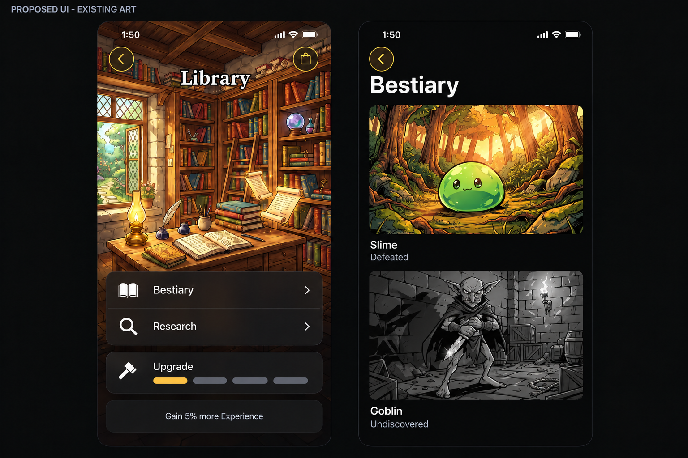
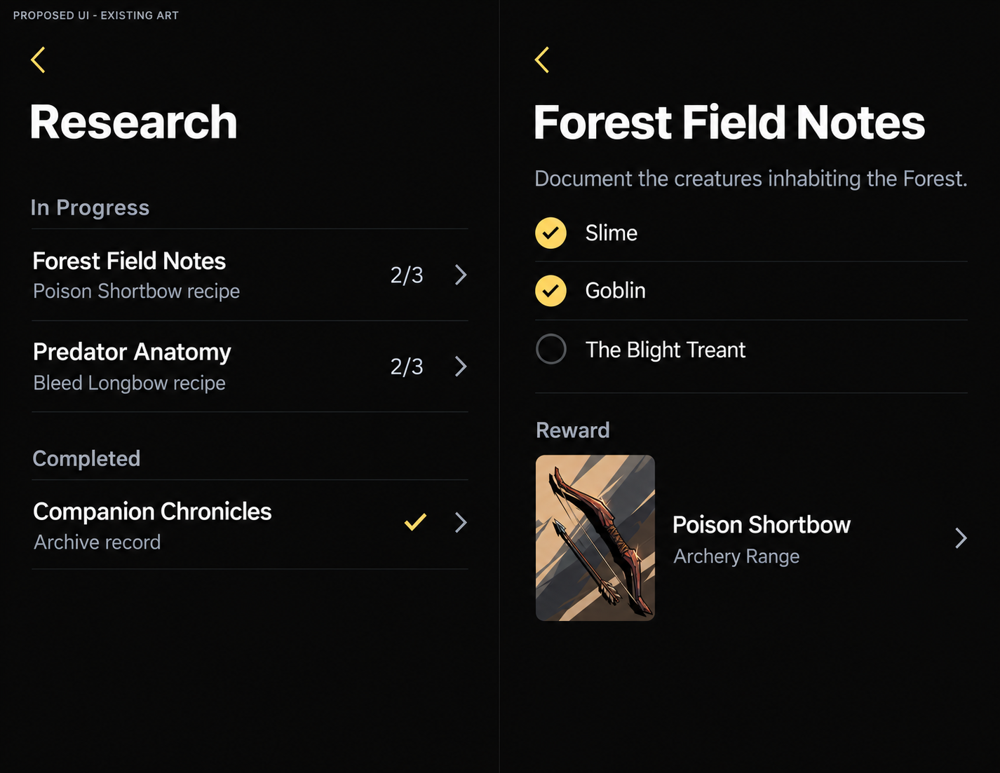
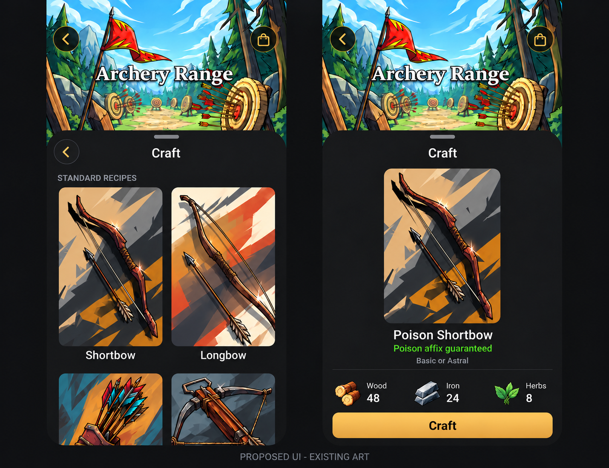

# Library, research, and Archery Range crafting

## Intent and disposition

Adventures fill the Library with discoveries. Completing finite research projects
teaches recipes that the player can use at Archery Range. Existing building,
creature, item, and resource artwork carries the expansion's identity.

This is a detailed design and implementation proposal, not a description of shipped
behavior. The user approved this direction and requested a detailed plan and
screenshot-based ImageGen mockups. This task delivers those planning artifacts;
game implementation remains intentionally unstarted. Numeric prices below are
proposed tuning inputs, not balance-verified values. Preserve this active plan for
implementation and use `--keep-plan` when handing off the planning task.

Source baseline: committed local main `5cb25b7d8`, inspected October 17, 2026.
The full plan was refined against local main `4787d3b69` on the same date.
Recheck source paths and current main when implementing. After implementation,
move durable behavior into canonical product/platform owners and retire this plan
under [plan lifecycle](README.md).

## Scope and product boundaries

Deliver together:

- Library Bestiary for enemies and bosses. Trinkets and Uniques remain in Collection.
- Five authored research projects, automatic objective tracking, and permanent
  completion records.
- Archery Range crafting: five standard recipes and three research recipes.
- Discovery persistence, bounded historical backfill, save recovery, reset, and
  existing internal-beta cloud synchronization support.
- Full localization and accessible native interactions for the added flows.

Region guides remain outside this cut. Runesmith, other workshops, consumables,
hunting activities, combat trials, and research currencies are outside this cut.
Hunter's Lodge retains its existing fieldcraft/companion identity and behavior.

Preserve the five Play modes, permanent Campaign/Spire completion, existing
Collection management, building costs/bonuses/production, immediate upgrades,
continuous battle input, and all existing Blacksmith recipes and prices. No new
game-art masters, asset-manifest entries, illustrated blueprints, equipment bases,
or sound assets. Generated mockups are documentation references, never app assets.

All three new Homestead activities follow current free-edition Homestead access.
Starter research must remain attainable with free content. An objective can count
an accessible Contract enemy without requiring completion of its Campaign region.
Research never grants access to premium floors or characters. Existing ownership
and inspection restrictions remain in force.

## Minimal UI contract

Let existing artwork identify the place and actual content identify the choice.
Use the existing native typography, materials, spacing and controls; do not create
a new visual system for research.

- Building details keep their painting and existing title. Bestiary/Research
  share one quiet activity group, above separate Upgrade and benefits panels.
- Reading screens use opaque semantic backgrounds and native titles. Reserve
  cinematic art for buildings and actual creature/item details; do not repeat
  the Library painting on every research page.
- Research uses one short scrolling list with In Progress and Completed sections.
  Five projects do not need a filter, dashboard, thumbnail tiles or global counter.
  Each row has a title, short reward label and one trailing progress/requirement.
- A project shows its title, objectives and one tappable reward row. The row
  opens the recipe; no second View Recipe button or permanent explanation of
  automatic progress is needed.
- Bestiary entries keep their catalog positions. Show actual landscape enemy art;
  undiscovered entries use that same artwork in grayscale with a text status.
  Do not separate, collapse or sort undiscovered enemies into another group.
- Every item image stays 3:4 portrait, including recipe cards, compact reward
  thumbnails, previews and results. Enemy images retain their landscape framing.
- Recipe costs and Craft are one decision in the safe-area dock. Craft is the only
  emphasized primary action; navigation/reward inspection stays quiet.
- Use native press/transition/selection feedback. Avoid decorative gold outlines,
  nested translucent panels, repeated icons, notification dots and idle animation.
  Keep paintings prominent rather than shrinking them to fit additional chrome.

These are acceptance criteria for native review, not pixel measurements from
ImageGen. Retain native text sizes and the platform/design-system minimum hit
areas. Simplifying appearance must not hide costs, requirements, status or navigation.

## Existing system and reuse

The [Homestead contract](../Product/Homestead.md) and current implementation provide
20 four-tier buildings in Farming, Crafting, Alchemy, Training, and Arcana. Buildings
are independently buildable. Galleries use existing 3:4 portrait crops; details
use full portrait backgrounds with Build/Upgrade and benefit panels.

Blacksmith alone has an activity. Its 11 recipes unlock at tier one. Its native
sheet progresses from recipe grid to cost preview to actual item reveal; tiers
two through four add 10/20/30% forge-only Astral weight. Ordinary forge results
use the highest won encounter level, capped at loot level 40, and permit the
selected base's unowned Unique. The rolled candidate survives silent save retries.

Reuse these specific owners:

| Existing owner | Reuse or bounded extension |
|---|---|
| [Building details](../../Trinket/Features/Homestead/HomesteadDetailViews.swift) | Library activities and Archery Craft beside the existing Blacksmith action |
| [Forge browser](../../Trinket/Features/Homestead/BlacksmithForgeView.swift) | Shared equipment-recipe grid and native sheet navigation |
| [Forge preview/reveal](../../Trinket/Features/Homestead/BlacksmithForgePreview.swift) | Material dock, admitted operation, same-item result, dismissal recovery |
| [Recipe catalog](../../Packages/TrinketContent/Sources/TrinketContent/Homestead/BlacksmithRecipe.swift) | Preserve existing IDs/costs while extracting the small common equipment recipe value |
| [Forge plan](../../Packages/TrinketContent/Sources/TrinketContent/Homestead/BlacksmithForgePlan.swift) | Immutable candidate and current-state revalidation |
| [Forge persistence](../../Packages/TrinketPersistence/Sources/TrinketPersistence/Inventory/BlacksmithForge.swift) | Atomic spending/insertion and cancellation-safe retry ownership |
| [Item reward generator](../../Packages/TrinketContent/Sources/TrinketContent/Equipment/ItemRewardGenerator.swift) | Tier filtering, base selection, keyword-affix guarantee |
| [Collection](../../Trinket/Features/Collection/CollectionView.swift) | Existing portrait/card labels and actual-item destination; equipment management stays here |

The existing save records current inventory and progression, not a complete
lifetime enemy encounter/defeat history. Only that history is added; existing
Collection owns Trinkets and Uniques, with no second item archive or item-discovery
tracking in Homestead. Do not infer lifetime Contract victories from a regenerating offer board.

## Player flows and screen specifications

### Library building

Keep its existing portrait, centered building title, Back/Resources controls,
four-tier progress, upgrade flow, and XP benefit. Above Upgrade show one restrained
activity group with two rows, separated by an inset divider:

1. **Bestiary**, small native book symbol and chevron.
2. **Research**, small native magnifying-glass symbol and chevron.

No progress subtitles or icon-background tiles on these entry rows. Upgrade and
the static XP benefit remain separate from the activity group and each other.

Tier zero exposes the activity rows with an adjacent `Build Library` requirement;
actions remain disabled until tier one. Tracking always runs. Building Library
applies already-earned facts immediately. Preserve the partially desaturated
unbuilt portrait and all material-only building rules. Completed Library keeps
both activity rows above its completed tier bar.

Use a full-height native push for Bestiary/research reading within the building's
navigation stack. Back returns to the same building position. Keep the building
detail's tab-bar treatment; do not introduce an independent tab or double sheets.

### Bestiary

Use the native title **Bestiary** and one scrolling catalog of the 39 existing
enemies, including seven bosses. This is a direct Library destination, without a
Field Guide hub, Creatures/Relics segmented control or duplicated Collection.
No new collectible category called Relics is introduced.

Keep all entries together in authored catalog order, regardless of discovery.
An undiscovered entry displays its actual existing landscape artwork in full
grayscale, its name and `Undiscovered`. Encountering it restores the original
color and changes the text to `Encountered`; victory changes that to `Defeated`.
Defeated implies encountered. Never reorder cards on discovery, hide them in a
disclosure, replace them with question marks, or split them into discovery groups.
Status text and VoiceOver convey discovery independently of color. Grayscale is
an image treatment, not a disabled-control treatment: all entries are inspectable.

Use one column at compact widths so landscape scenes have room to breathe.
Enemy card and detail images preserve the selected source's landscape aspect
ratio and composition (the supplied Slime/Goblin masters are 1200×896, about 4:3).
Do not force enemies into portrait cards or panoramic 16:9 crops. Wider layouts
may add columns while retaining that framing. Names and one quiet status line sit
below the image. Use existing prepared landscape artwork variants, not newly
painted or generated crops. No aggregate progress header, filter or native search
is needed unless rendered review demonstrates a finding problem.

Enemy detail reuses landscape art and canonical traits/ability descriptions,
then shows related project progress. Numeric enemy values must name their level;
reuse the current Standard Contract policy and clearly label that reference,
without adding a level picker or parallel scaling formula. Existing encounter
inspection remains authoritative for that encounter. Combat information is never
withheld behind research. Merely inspecting an enemy in Contracts or the Bestiary
does not count as encountering it. An undiscovered detail retains grayscale art
and the explicit status while keeping its information readable.

With no encounters, retain the full grayscale catalog. One short contextual hint
may explain that encountering enemies reveals their colors; no empty screen,
compulsory onboarding, new notification badge or forced tutorial.

### Research browser and project detail

Use a single list with In Progress and Completed sections, omitting empty sections.
Keep authored order within each section, captured for the visit. A newly completed
row updates in place; move it to Completed on the next visit rather than animating
the player's current target away. Completed is already its status label.

Rows use a title, concise reward subtitle and one trailing value, for example
`Forest Field Notes` / `Poison Shortbow recipe` / `2/3`. If facts are complete but
Library tier is insufficient, show `Library II` instead of the fraction; opening
the project shows all objective checks and the requirement. VoiceOver receives
the full objective count and requirement, not an unexplained fraction. Avoid
decorative thumbnails, duplicated keyword icons, extra progress bars and a filter.

Project detail is a quiet reading page: native title, short purpose only where it
adds context, explicit objective rows, and one tappable reward row. Recipe rewards
use a small existing **3:4 portrait** item thumbnail (for example 54×72 pt),
recipe name, workshop and chevron. Never crop the thumbnail square. Archive
records use text with a native symbol only if it improves recognition. No repeated
Library hero, oversized reward heading, separate View Recipe button, or permanent
`Research completes automatically` footer. Show checks plus text, not color alone.
There is no Accept, timer, active slot, currency, donation cost or manual claim.

Named creature objectives can open existing enemy inspection even before an
actual encounter; undiscovered Bestiary entries remain inspectable. Reading
this information never records an encounter. A project with a remaining target
offers textual source guidance in detail, using the existing modes and actual
regional pools; do not promise an available Contract or auto-start a battle.

Every project tracks all relevant facts automatically. Completion requires its
facts AND minimum Library tier. The player can finish facts before building or
upgrading; the next eligible Library upgrade completes the project without
repeating play. Completed projects and taught recipes are permanent within
the save/reset epoch. Both archive milestones require only Library I; do not
gate their records behind an unrelated late upgrade. Recipe studies retain
Library I/II/III requirements. Library IV still increases its existing XP benefit;
it does not need another activity or filler research unlock. No pinning feature
is required in this cut.

### Archery Range

Keep its current portrait, ranged-damage benefit, Wood production, upgrades, and
resource access. A built Range adds **Craft** above Upgrade, using a native
bow-and-arrow symbol. Tier zero shows the build requirement consistently with
Library. No prerequisite Library building is imposed on standard crafting.

Craft opens the same kind of native sheet as Forge. Standard Recipes uses the
five equipment cards below. Focused Recipes uses compact rows, reusing the base
3:4 portrait thumbnail with keyword text, not another large grid of the same
item paintings. Standard cards, focused thumbnails, previews and actual results
all keep 3:4 item framing. Costs retain their existing resource-icon proportions.
Use the system section-title role. Show learned entries first, then locked entries
in catalog order captured on opening. Locked entries remain inspectable and name
their research project; returning from research preserves browsing position.

Recipe preview uses the existing material dock and portrait/name arrangement.
Focused previews additionally state `Guarantees a Poison affix` (or the actual
keyword) and `Basic or Astral`, grouped beside the recipe name rather than scattered
around the sheet. Recipe titles such as Poison Shortbow describe a crafting
guarantee; they do not rename the crafted Shortbow base or create a collectible.
Locked previews replace Craft with a visible requirement and a View Research
action; no button that appears to spend resources.
Unavailable material quantities use the existing insufficient-cost styling.
Ordinary previews retain Forge's concise presentation.

On Craft, disable duplicate submission and show only the existing pending visual.
Spend resources and insert the exact candidate before success feedback. Reveal
the actual item through the current item-detail pattern. No automatic equip.
Reopening the saved result never crafts again. Background/navigation suppresses
late presentation but preserves any accepted item.

Cross-links carry stable IDs and an origin in the current Homestead path:

- Library project to recipe: show a read-only recipe preview on the current
  stack. Its action is Open Archery Range, never a remote Craft operation.
- Open Archery Range: navigate to that building, then present its one Craft sheet
  with the selected recipe. The player commits crafting only there. An unbuilt
  Range instead shows its building detail and normal Build requirement.
- Range recipe to research: push a read-only project detail inside the existing
  Craft sheet, even if Library is unbuilt. Explain the building/tier requirement
  there; inspection does not complete research or bypass building requirements.
- When a linked project/recipe is already an ancestor, pop to it. Never append a
  second copy in a Research-to-Recipe-to-Research loop. Back restores the actual
  origin and scroll position. Dismissal closes the sheet, not the underlying
  building. Keep one sheet and one local navigation path; no new global router.

## Initial research catalog

Five projects, three recipe unlocks, two permanent archive passages. There is no
Trinket/Unique collection project or parallel item archive. Lore passages
below are initial copy proposals, subject to separate editorial/localization
review. This cut adds no material, Gold, XP, or permanent-stat rewards to research.

| Stable project ID | Library tier | Objectives (maximum three) | Reward |
|---|---:|---|---|
| `forest-field-notes` | 1 | Defeat Slime; defeat Goblin; defeat The Blight Treant | `archery-shortbow-poison` |
| `predator-anatomy` | 2 | Defeat Giant Spider; defeat Giant Snake; defeat Dire Wolf | `archery-longbow-bleed` |
| `companion-chronicles` | 1 | Recruit three distinct Companions, including the starter | Archive passage: Companion Chronicles |
| `arms-and-armor` | 3 | Defeat Goblin; defeat Bandit; defeat Living Armor | `archery-crossbow-physical` |
| `spire-records` | 1 | Clear floor 10 of any Spire | Archive passage: Spire Records |

Every project has one to three independently completable objective rows. Each
named defeat target is one objective; Forest Field Notes genuinely needs only
three enemies. Do not conceal longer checklists inside a grouped objective.
Companion Chronicles has one count objective (three distinct recruits), and Spire
Records has one floor objective. A Library-tier requirement is quiet prerequisite
text, not an extra objective checkbox. Validate this limit in the authored catalog.

Enemy IDs come from the actual catalog: `slime`, `goblin`,
`the_blight_treant`, `giant_spider`, `giant_snake`, `dire_wolf`,
`bandit`, `living_armor`. Duplicate kills never substitute for another objective.
Named targets can be encountered through existing modes; Contracts ordinarily
draws from the full ordinary/boss pools. Do not add forced target spawning or
Contract rerolls. Explain known source regions and Contracts as possible sources
without promising a currently available offer.

Source guidance should also expose known deterministic opportunities. At this
baseline, Serpent Hollow floors 1/2 supply Giant Spider/Giant Snake, Sanguine Court
floor 2 supplies Dire Wolf, and Iron Vein floors 1/2/4 supply Goblin/Bandit/Living
Armor. Derive hints from current catalog data rather than maintain a parallel
enemy-location list. Respect permanent completion: a cleared floor is historical
context, not a replay button. Use Voyage/Contracts/Labyrinth guidance for repeat
opportunities without asserting that a random target is currently available.

Initial archive passages:

- **Companion Chronicles:** No two companions approach a battle alike. These
  records preserve the growing company that shares your adventures.
- **Spire Records:** Each Spire turns one form of power into a different trial.
  Reaching its tenth floor earns a place in the Library's climbing records.

Passages appear in completed project details. These two entries are optional
adventure milestones, not an additional source of combat power or a promise of
substantial new story content. No illustrated book or separate reward item.
Creature pages can link to multiple projects without a research rank. Future
edits must preserve already-earned rewards and stable IDs.

## Recipe catalog and economic rules

Proposed material costs use existing resources; tune before shipping against
Blacksmith, salvage yields, battle income, and passive production. Numbers are
explicit starting points so implementation has a reviewable catalog.

| Recipe ID | Base | Requirement | Wood | Iron | Hide | Herbs | Guarantee |
|---|---|---|---:|---:|---:|---:|---|
| `archery-shortbow` | Shortbow | Range I | 32 | 16 | 0 | 0 | Standard |
| `archery-longbow` | Longbow | Range I | 40 | 20 | 0 | 0 | Standard |
| `archery-recurve-bow` | Recurve Bow | Range I | 40 | 20 | 0 | 0 | Standard |
| `archery-crossbow` | Crossbow | Range I | 32 | 32 | 0 | 0 | Standard |
| `archery-quiver` | Quiver | Range I | 16 | 0 | 32 | 0 | Standard |
| `archery-shortbow-poison` | Shortbow | Forest Field Notes | 48 | 24 | 0 | 8 | Poison affix |
| `archery-longbow-bleed` | Longbow | Predator Anatomy | 60 | 30 | 12 | 0 | Bleed affix |
| `archery-crossbow-physical` | Crossbow | Arms and Armor | 48 | 48 | 0 | 0 | Physical affix |

All focused recipes also require a built Range. The project, rather than a second
Range-tier gate, controls recipe learning. Higher Range tiers add the same
10/20/30% forge-only Astral weight progression used by Blacksmith; they do not add
affixes, alter guarantees, or increase base item power. Preserve existing
combat/production tiers. Add the crafting benefit to Range descriptions during
implementation, with localization.

Standard recipes follow the existing forge's Basic/Astral/selected-base Unique
policy, excluding Trinkets. Focused recipes use only Basic/Astral, renormalizing
the same eligible tier weights. Their one guaranteed keyword affix occupies a
normal affix slot; remaining affixes and magnitudes roll normally. Guarantee the
keyword, not a particular signature, numerical magnitude, or stronger rarity.

Reuse the highest-won reward level with its existing loot-level cap. Never use
research or a roster-only level increase as a new loot-quality source. Generate
on admitted Craft and retain one immutable candidate through retries. Each
deliberate new craft gets a new physical item ID and pays again. Shared ownership
and duplicate-Unique rules apply.

Important current generator detail: with `requiredKeyword`, base selection examines
`baseTypes` BEFORE `fallbackBaseType`. A fixed-base focused recipe must constrain
`baseTypes` to its single selected base as well as validate a reachable affix.
Passing only a fallback can yield a different equipment base. Verify recipe base,
keyword reachability, and allowed tiers at catalog construction/check time.

## Feedback and reachable states

Research progress commits with the gameplay operation that earns it. A victory
may add one compact Research Complete row after ordinary reward information;
coalesce multiple completions and keep the normal Continue flow. Recipe unlock
text names both recipe and workshop. No forced modal or automatic departure from
Play. Reopening a result must not replay completion sound/haptics. Return newly
completed IDs with the successful domain outcome and consume that transient
presentation once. Do not reconstruct celebrations on view appearance by comparing
all saved completions, and do not persist a separate notification inbox.

Building/upgrading Library may complete older projects. Finish the existing build
celebration first, then expose a quiet `N research projects complete` summary linked
to Research. Backfilled discoveries do not queue historical victory notifications.
Completion records remain visible if transient notification is interrupted.

| State | Expected behavior |
|---|---|
| No encounters | Show the full grayscale Bestiary with names/status; entries remain inspectable |
| Objective met, Library tier too low | Show checks and required Library tier; no recipe grant yet |
| Project complete, Range unbuilt | Recipe learned permanently; show Build Archery Range requirement |
| All research complete | Show Completed with archive entries and recipe links; no empty In Progress panel |
| Missing materials | Inspectable recipe, exact insufficient costs, disabled Craft |
| Pending save | Existing pending treatment and silent retry; no success yet |
| Interrupted accepted craft | Item remains in Collection; no late forced navigation |
| Reset/account change | Retire old callbacks/destinations; reset history only with game progress |
| Full Game access changes | Preserve history; respect access and inspection rules |
| Unknown/damaged discovery data | Preserve bytes and isolate activity availability; keep ordinary play and standard crafting available |

Use existing typography, semantic keyword colors, safe-area resource docks,
native large-text wrapping, reduced-motion behavior, and explicit image labels or
decorative semantics. Critical controls get stable accessibility IDs. No custom
accessibility mode or device-specific layout branch.

## Economic review before implementation

The current [salvage rules](../../Packages/TrinketContent/Sources/TrinketContent/Equipment/ItemSalvage.swift)
return 8 Iron + 4 Wood for a Basic Weapon-slot item and 16 Iron + 8 Wood for an
Astral one, including Quiver. Trinkets and Uniques cannot be salvaged. The proposed
Shortbow spends 16 Iron + 32 Wood, so even its Astral outcome loses 24 Wood; Quiver
spends Hide/Wood and returns Iron/Wood. That is a material conversion, not a free
Iron source. Evaluate combinations with Blacksmith and resource exchanges rather
than requiring every craft to lose every individual resource.

No proposed Range craft returns all its inputs through salvage. This establishes
only that narrow arithmetic check, not expected loot value or good prices.
Validate ordinary/focused Basic/Astral outcomes, Unique eligibility and conversion
cycles during tuning. A focused guarantee is useful even when rarity is Basic;
it does not promise higher item power.

## Artwork and mockup references

Only existing art selected in [the curated manifest](../../ArtManifest/curated-assets.tsv)
may ship. Use cropped variants and imminent owner pins; do not preload the entire
Bestiary. Preserve artwork budgets. Native symbols handle books, magnifiers,
checks and navigation. Enemy art uses existing landscape variants; all item art
uses existing 3:4 portrait variants, including the smallest thumbnails.

| Surface | Existing manifest identity |
|---|---|
| Library building | `portrait_background / library`, landscape `background / library` |
| Archery building | `portrait_background / archeryRange`, landscape `background / archeryRange` |
| Landscape Bestiary cards/details | `combatant / <actual enemy ID>` |
| Standard/focused recipe art | `item / shortbow-basic`, `longbow-basic`, `recurve_bow-basic`, `crossbow-basic`, `quiver-basic` |
| Actual crafted result | Existing item-art reference, including Astral/Unique mapping |
| Costs | Existing Wood, Iron, Hide, Herbs resource illustrations |

Three refined screenshot-guided ImageGen boards accompany this plan: Library/Bestiary,
research list/detail, and Archery browser/preview. They are proposed UI, not
implemented features or pixel-accurate SwiftUI specifications. Written rules take
precedence when labels/spacing differ. Illustrative counts/prices show example
states, not real save evidence or validated balance. Reference provenance, exact
prompts and visual review are in [mockup notes](LibraryResearchArchery/Mockups.md).







## Ownership and proposed data contract

Use existing packages. No new package, generic quest engine, workflow service,
event bus, or public protocol is needed.

| Owner | Responsibility |
|---|---|
| TrinketContent | Typed project definitions/objectives, recipes, immutable discovery/research values, pure evaluation and craft candidate rules |
| TrinketPersistence | Authoritative fact admission, durable records and unlocks, atomic crafting/economic receipts, migration/backfill/reset/recovery/cloud merge |
| TrinketAppState | Actual battle-activation/outcome facts and transient navigation/completion presentation |
| Trinket feature UI | Bestiary, research, activity links and crafting observing narrow save slices |
| TrinketFeatureSupport/DesignSystem | Reuse cards, detail views, feedback and accessibility IDs; add only truly shared pieces |

Proposed Content values, names subject to call-site review:

```text
DiscoveryState
  encounteredEnemyIDs: Set<String>
  defeatedEnemyIDs: Set<String>
  completedResearchIDs: Set<String>
  unlockedRecipeIDs: Set<String>

ResearchProject
  id, localized title/purpose
  minimumLibraryTier, typed objectives, recipe-or-archive reward

ResearchObjective
  defeat(enemyID)
  recruitDistinctCompanions(count)
  reachAnySpireFloor(floor)

EquipmentRecipe
  stable id, buildingID, baseID, cost, optional projectID
  optional requiredKeyword, tier policy
```

Do not store display counts, per-project duplicate kill counters, enemy statistics,
rolled items, or localized text in history. Progress derives from sets and
existing roster/Spire facts. Persist completed project IDs and earned recipe IDs
so catalog retirement does not revoke rewards. Keep unknown stable IDs inert and
round-trippable; grant no unknown effects. Enforce defeated as a subset of
encountered on readable state.

Each project contains 1...3 objective values; a defeat objective names exactly
one enemy. A count objective measures one action category without nested target
checklists. Count the starter Companion's real unlocked ID once, not both
starter-selection state and roster membership. No new item-discovery set, item
acquisition hooks or historical item backfill are needed for this scope.

Definitions are a small authored Swift catalog beside existing Homestead content;
avoid a new manifest/generator DSL for five projects. Recipe models can be shared
between Blacksmith and Range because both are confirmed consumers. Preserve
Blacksmith IDs and behavior; review consumers before deleting old APIs.

## Fact admission and transactional invariants

1. **Encountered:** accept the resolved enemy ID only after runtime activation
   succeeds. Preview/preparation/inspection/failed activation do not count. Use a
   generation-bound, idempotent save command and existing silent retry; never gate
   card input or add mid-battle save/resume. A process interruption before this
   record commits cannot promise encounter-history survival; an accepted victory
   also records encountered.
2. **Defeated:** record the actual launched enemy ID with accepted victory
   settlement in every mode. Carry it in the save-issued claim/launch context;
   never reconstruct random encounters from current UI or a replaced offer.
   Duplicate/stale claims grant nothing. Defeat/retreat grants no defeated flag.
3. **Research:** evaluate relevant projects after enemy facts, roster recruitment,
   Spire progress, or Library upgrade in the same candidate transaction. Persist
   completion and taught recipes with the triggering change. Recipe grants are
   set insertion, so retries/cloud replay cannot grant twice.
4. **Craft:** resolve recipe ID against the current catalog, building tier, learned
   records, access, ownership and balances inside Persistence. Roll once, retain
   the candidate, revalidate each attempt, and commit resource debit/item
   insertion together. Use the existing economic receipt path; neither
   UI nor Content writes journals or supplies trusted prices.

Keep fact collection at owning transactions with one pure evaluator. Avoid
scanning/re-evaluating the entire catalog on unrelated wallet/selection changes,
or installing feature observers in the save-store hub. Transient presentation
derives from committed before/after IDs and never performs a second reward transaction.
Generation changes invalidate retained commands, pending craft presentations,
and cross-links to obsolete state.

## Save migration, recovery, and cloud compatibility

Implement a dedicated versioned discovery payload as an optional save-root field
and a narrow observed store slice, separate from resource production. Follow the
opaque-payload preservation pattern used for Voyage: absent means initialize and
backfill, unsupported/unreadable means preserve and isolate, not silently reset.
Standard Range crafting can work without readable discovery; focused eligibility
requires trusted learned records.

At this baseline, PlayerSave wire version is 18 and SwiftData has its own distinct
schema/migration plan. Adding an optional JSON key alone is insufficient: an older
writer could read the same known version and omit new history on its next write.
Advance the wire format with an explicit legacy-reader migration; if the baseline
is still 18, the proposal is 18-to-19. New readers upgrade complete legacy
snapshots, including recovery files and cloud ancestor/outbox snapshots/deltas.
Older readers reject newer formats safely and retain their progress instead of
writing a stripped version back. A legacy same-epoch import with no discovery
data cannot erase known discovery sets on a current reader.

Freeze prior SwiftData models as needed and test the additive graph migration
separately. Do not confuse payload, wire and SwiftData versions, or simply change
an equality constant that currently rejects old recovery snapshots. Migration
must cover distributed TestFlight saves. Future payload bytes remain preserved
and inert when unsupported.

Trace the field through PlayerSave, PlayerSaveSection domain comparison, root
mapping/write validation/repair, local recovery snapshots, CloudSaveSnapshot
(currently the same codec), CloudSaveSnapshotDelta, outbox replay, merge,
sanitization, fresh/test states, reset, and cloud hasProgress classification.
Encoding failure must not publish a partial completion or lose the older payload.
Verify a disk reload, not merely an observed in-memory value.

Historical backfill is repeatable and unions provable facts:

- Unlocked Companions and Spire floors establish their project facts.
- Fixed-enemy Campaign stages and Spire floors can establish defeats only through
  a reviewed, frozen legacy-ID mapping valid for supported save versions. Current
  catalog contents alone are not evidence when an enemy may have changed; skip
  ambiguous credits.
- Retained cleared Labyrinth/Voyage nodes establish defeats where the saved
  resolved enemy ID is unambiguous. Ignore current/random previews.
- A random Campaign stage with no saved target, replaced Contract offer,
  or discarded route does not prove a specific enemy discovery.

Do not invent lifetime totals or award every enemy in a completed region. Show
no historical celebration queue. Run backfill for each payload/catalog migration
version, safely resumable inside the durable commit boundary; later awards are
event-based. Store a backfill version in the payload envelope; an empty discovery
set must not mean uninitialized, since empty is valid for a fresh player. A
catalog change cannot rewrite historical enemies. Named targets remain available
through repeatable modes when conservative backfill skips a credit.

Within the same cloud account/reset epoch, readable history/completion/recipe
sets merge by union; evaluate projects after combined evidence merges. Never
merge old-epoch history into a reset save. Unknown payload versions retain
unsupported-save protections, not guessed union. Two devices completing one
project learn its recipe once. Research adds no economic payout. Craft spending
retains the existing journal's double-spend/replay rules. No cloud enablement
expansion or live Apple ID requirement is introduced.

## Implementation sequence

- [x] Inspect Homestead/Forge, catalogs, saves and screenshots; identify existing
  artwork and record source baseline.
- [x] Produce this design and screenshot-guided ImageGen concepts; leave runtime
  implementation unstarted in this planning task.
- [ ] **1. Content contracts:** five projects, eight Range recipes, typed objectives
  and pure evaluation. Validate IDs, enemies, reachable keyword affixes, tier
  requirements, the three-objective maximum and costs. Extract the confirmed shared
  crafting values while preserving Blacksmith.
- [ ] **2. Durable discoveries:** payload/version migration, observed slice,
  backfill, storage/codec/delta/merge/reset paths, immutable projections, and
  recovery/reload/merge/mixed-version proofs before UI relies on them. Freeze
  proven legacy encounter mappings and use a separate backfill marker.
- [ ] **3. Gameplay facts:** extend launched battle claim context, record actual
  encounters and accepted victories across all five modes, and evaluate after
  recruitment, Spire progress and Library upgrades.
- [ ] **4. Archery crafting:** reuse immutable candidate and economic retry
  patterns; implement standard/focused eligibility and base/tier guarantees.
  Verify exact identity, costs, and no profitable craft-salvage exchange loop.
- [ ] **5. UI:** Library activities, Bestiary, research, Range Craft, preview/reveal
  and bounded cross-navigation. Reuse cards, artwork pins, feedback, accessibility
  IDs without duplicating Collection. Check the Minimal UI contract, in-place
  grayscale discovery, landscape enemies, portrait items, three-objective maximum,
  stable list ordering and return-to-origin navigation before adding chrome.
- [ ] **6. Localization/native review:** run the repository translation plan,
  translate all configured languages, perform separate AI review, apply reviewed
  responses, and rerun check. Exercise supported compact/expanded/rotated windows,
  large text, sound/haptics off, and relevant Reduce Motion.
- [ ] **7. Balance/closure:** validate prices and pacing, review combined main,
  run required handoff and hosted gates when authorized, move durable rules into
  canonical owners, retire this plan and obsolete supporting mockups.

Use isolated task branches and locked integration. Normal local verification stays
resource-light; deliberate native visual review uses a managed simulator/device
lease. Do not launch a broad build merely because this plan exists.

## High-value verification and acceptance

Prefer existing suites and consequential additions under the
[test value rubric](../Platform/Testing.md#coverage-decision-new-and-changed-behavior).
Do not write tests that merely mirror these five catalog rows.

| Boundary | Required evidence during implementation |
|---|---|
| Automatic completion | One fact completes eligible projects once; low Library tier retains progress; upgrade finishes them without repeated play |
| Actual enemy identity | Random battle/replaced offer/party change cannot misattribute victory; prepared/failed launches do not count |
| Persistence | Legacy snapshot/delta/recovery migrates; backfill idempotent with proven IDs; empty differs from uninitialized; failed write rolls back facts/unlocks |
| Mixed versions | Old writer rejects new format without overwriting progress; legacy import cannot erase discoveries; unsupported payload bytes survive |
| Cloud/reset | Same-epoch union and combined objectives; duplicate completion harmless; stale epoch/callback cannot resurrect history |
| Focused recipe | Exact base and keyword for Basic/Astral, normal affix slots, no collectible outcome or alternate-base fallback |
| Craft lifetime | Locked/unbuilt/insufficient/stale spends nothing; retry retains exact item; reopen/background/reset cannot charge twice or grant late |
| Forge regression | Existing 11 recipes, IDs, costs, quality, selected-base Unique and reveal unchanged |
| Native flow | Project/recipe links return to origin without stack growth or nested sheets; only Range commits crafting; named unknown targets remain inspectable |
| Minimal presentation | Bestiary and Research only; grayscale entries stay in place and inspectable; maximum three objectives; no redundant collection/counters/heroes/filters; cost dock remains usable |
| Artwork | Existing manifest entries only; landscape enemy cards/details and 3:4 item images at every size; mockups excluded from runtime; no whole-Bestiary full-resolution warmup |

Verify interrupted feedback and reopening never replay a historical celebration.

Rendered review must compare shipping SwiftUI with mockup intent, including text
fit, landscape enemy compositions, portrait item thumbnails/previews, native bars,
safe-area Craft dock, insufficient materials,
and completed buildings. ImageGen concepts do not prove implementation appearance,
accessibility, or interaction correctness.

Before shipping, compare early/mid/late resource income with all eight prices,
salvage yields at both tiers, standard/focused tradeoffs, and first-recipe pacing
on fresh/established saves. Adjust the authored catalog and active plan together.
No elapsed-time promise is established by these prices or mockups.

## Planning handoff and remaining decisions

The defaults above resolve the initial cut: Bestiary and Research, five projects,
three focused recipes, no consumables/research economy, existing Homestead free
access, automatic progress/completion, tiered recipe studies and tier-one archive
milestones. Outstanding work is price/pacing evidence and archive copy/localization
review during implementation, not a blocker to finishing these planning artifacts.

Planning validation: review linked owners, verify art identities against the
manifest, inspect boards and record limitations, run scoped documentation and
lightweight handoff with this intentionally active plan retained. No runtime
compilation or simulator behavior is claimed for this planning task.
